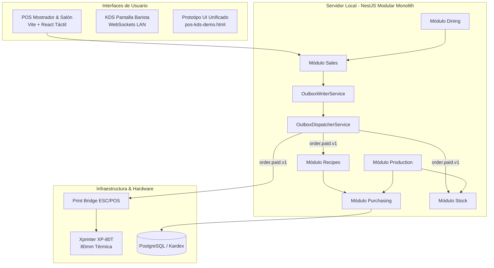

# CoffeeOS — BENEVENTO
> **Heladería • Pastelería • Cafetería de Especialidad**  
> *Sistema operativo modular de punto de venta (POS), KDS de barista, control de insumos por escandallo, salón y producción.*

---

## ☕ 1. Visión del Proyecto

**CoffeeOS** es una plataforma modular y resiliente construida bajo una arquitectura **Local-First** y **Monolito Modular guiado por eventos (Transactional Outbox)**, diseñada específicamente para el ritmo operativo de **BENEVENTO**:
- **Pay-First en Mostrador**: Atención en caja en menos de 20 segundos con personalización de bebidas (tamaños, leches vegetales, jarabes, shots extra).
- **Control de Salón y Mesas**: Comandas abiertas, rondas continuas, pre-cuenta térmica con propina voluntaria (10%) y división de cuentas (Split Check).
- **Inventario Dual**: Coexistencia sin fricción entre productos terminados de vitrina por unidad (`BY_UNIT`) e insumos dosificados por receta en barra (`BY_RECIPE`).
- **Obrador y Producción**: Recetas maestras de panadería/heladería, costeo real por lotes de horneado y traslado directo a vitrina.
- **Hardware Integrado**: Impresión nativa ESC/POS en 80mm y pulso de cajón portamonedas para **Xprinter XP-80T**.

---

## 🚀 2. Estado del Desarrollo (Etapas A, B y C 100% Completadas)

| Etapa | Módulos | Estado |
| :--- | :--- | :--- |
| **Etapa A** | Cimientos, Catálogo, Turnos de Caja, POS Mostrador, Impresión ESC/POS, KDS Barista, Pagos Mixtos, Correcciones (PIN) y Reportes/Cierre Z | ✅ **100% Completada** |
| **Etapa B** | Stock de Vitrina, Compras, Proveedores, Kardex (CPP), Recetas de Taza y Mermas/Calibración Matutina de Molino | ✅ **100% Completada** |
| **Etapa C** | Salón, Mesas Físicas, Cuentas Abiertas, Transferencias, Pre-cuenta y Producción / Obrador de Pastelería | ✅ **100% Completada** |
| **Etapa D** | Fidelización (`CustomerPort`), Pick-up & QR Online, BI Avanzado de Márgenes | 🚀 *Próxima Etapa* |

---

## 🏛️ 3. Arquitectura y Principios de Diseño



### Principios Fundamentales:
1. **Transactional Outbox e Idempotencia**: Cada orden se guarda atómicamente junto con su evento en `outbox_events`. Los suscriptores procesan eventos a través de `processed_events` asegurando cero duplicados.
2. **Límites Modulares Estrictos (`.dependency-cruiser.js`)**: Ningún módulo puede importar directamente archivos internos de otro módulo; la comunicación se realiza exclusivamente mediante `index.ts` o puertos desacoplados (`IngredientStockPort`, `AvailabilityPort`).
3. **Cálculo de Caja en Tiempo Real**: El cuadre de turno y efectivo esperado se deriva sincrónicamente desde las transacciones reales, evitando desajustes por asincronía.
4. **Precisión Financiera**: Manejo de valores monetarios en centavos enteros (`Money`) para eliminar errores de redondeo de punto flotante.

---

## 📦 4. Módulos del Sistema

### 🛒 Ventas, Caja y Catálogo
- **`catalog`**: Catálogo oficial de BENEVENTO (Cafetería, Heladería, Pastelería Fina, Salados), modificadores agrupados y soporte de IGV (18%).
- **`cash`**: Apertura con fondo de sencillo, registro de egresos en efectivo, arqueo ciego y cálculo de diferencia de cierre.
- **`sales`**: Venta rápida en mostrador, pagos multimedio (Efectivo con vuelto, Yape, Plin, Tarjeta), propinas, anulaciones y devoluciones con PIN de supervisor y auditoría (`AUDIT_LOG`).
- **`dispatch`**: Pantalla KDS para baristas con semáforo SLA (&lt;90s óptimo, 90-180s alerta, &gt;180s urgente) y modificadores destacados legibles a 1.5 metros.

### 📊 Insumos, Costos y Recetas
- **`stock`**: Control unitario para vitrina (`BY_UNIT`) con alerta de bajo stock y agotado automático en POS.
- **`purchasing`**: Registro de proveedores con RUC, compras con recálculo dinámico del **Costo Promedio Ponderado (CPP)** y Kardex permanente con 6 tipos de movimientos.
- **`recipes`**: Escandallo de barra al gramo y mililitro, modificadores con reglas de impacto (`SUBSTITUTE`, `ADD`, `REMOVE`) y reglas de empaque (`TAKEAWAY` vs `DINE_IN`).
- **`waste`**: Calibración matutina de molinos de espresso (*Dial-in*), bebidas rehechas (`REMAKE`), derrames y autorizaciones de merma por PIN.

### 🍽️ Salón y Producción
- **`dining`**: Mesas físicas por zonas (*Salón*, *Terraza*, *Barra*), comandas abiertas con rondas continuas, cambio/transferencia de mesa, unión de mesas, pre-cuenta con sugerencia de propina del 10% y división de cuentas (Split Check equitativo o por ítems).
- **`production`**: Recetas maestras de panadería/heladería, órdenes de producción por lotes (`ProductionBatch`), deducción de materias primas en Kardex (`PRODUCTION_CONSUMPTION`), cálculo de eficiencia de horneado y traslado automático a vitrina con costo unitario real.

---

## 🎨 5. Prototipo Interactivo de UI

El sistema incluye una aplicación táctil interactiva que simula la operación real:
- **Archivo Local**: [`public/pos-kds-demo.html`](public/pos-kds-demo.html)
- **Funcionalidades**:
  - POS de mostrador táctil con filtros de categoría.
  - Modal dinámico de modificadores (tamaños, tipo de leche, extra shots, jarabes).
  - Selector de modalidad: *Salón* (`DINE_IN`) vs *Para Llevar* (`TAKEAWAY`).
  - Cobro con calculadora rápida de vuelto en soles, simulación de QR (Yape/Plin) y terminal POS.
  - Visor en vivo de ticket térmico para **Xprinter XP-80T** (80mm) con comandos ESC/POS de corte y pulso de gaveta.
  - Pantalla KDS de barista con temporizadores y transiciones de estado táctiles.

---

## 📂 6. Estructura del Proyecto

```
Proy Cafeteria/
├── data/
│   └── benevento-menu-seed.csv         # Menú oficial cargado al sistema
├── public/
│   └── pos-kds-demo.html               # Prototipo visual interactivo
├── src/
│   ├── shared-kernel/                  # Tipos base: Money, Entity, DomainEvent
│   ├── platform/                       # Infraestructura transversal
│   │   ├── auth/                       # Usuarios, roles, PIN hash
│   │   ├── audit/                      # Trazabilidad en audit_log
│   │   ├── outbox/                     # Transactional Outbox & Dispatcher
│   │   ├── print-bridge/               # Controlador ESC/POS y plantillas térmicas
│   │   └── theme/                      # Tokens visuales de marca BENEVENTO
│   ├── modules/                        # Dominios de negocio independientes
│   │   ├── catalog/                    # Productos, variantes y modificadores
│   │   ├── cash/                       # Turnos, arqueo ciego y caja
│   │   ├── sales/                      # Órdenes, pagos y correcciones
│   │   ├── dispatch/                   # KDS y comandas
│   │   ├── reports/                    # Reporte diario y Cierre Z
│   │   ├── stock/                      # Stock unitario de vitrina
│   │   ├── purchasing/                 # Compras, proveedores y Kardex CPP
│   │   ├── recipes/                    # Recetas de taza y escandallo
│   │   ├── waste/                      # Mermas y calibración de molinos
│   │   ├── dining/                     # Mesas, cuentas de salón y pre-cuenta
│   │   └── production/                 # Obrador, recetas maestras y lotes
│   ├── app.module.ts                   # Módulo raíz de NestJS
│   └── main.ts
├── test/                               # Suites de pruebas automatizadas por módulo
│   ├── catalog.spec.ts
│   ├── cash.spec.ts
│   ├── sales-cash-pos.spec.ts
│   ├── kds-barista.spec.ts
│   ├── purchases-kardex.spec.ts
│   ├── step11-punto3-outbox-recipe-deduction.spec.ts
│   ├── waste-and-calibration.spec.ts
│   ├── dining-room-service.spec.ts
│   └── production-baking-batch.spec.ts
├── .dependency-cruiser.js              # Reglas de protección antiacoplamiento
├── tsconfig.json
└── package.json
```

---

## 🧪 7. Pruebas Automatizadas

Cada módulo cuenta con una suite completa de pruebas unitarias y de integración:

```bash
# Ejecutar todas las pruebas del sistema
npm test

# Ejecutar pruebas de un dominio específico
npm test test/dining-room-service.spec.ts
npm test test/production-baking-batch.spec.ts
npm test test/step11-punto3-outbox-recipe-deduction.spec.ts

# Verificar reglas de aislamiento arquitectónico entre módulos
npm run check:boundaries
```

---

## 📋 8. Identidad Visual de Marca (BENEVENTO)

El diseño de interfaces y tickets sigue la paleta de tokens oficial de la marca:
- **Cyan Principal (`#00B4D8`)**: Botón principal de cobro y acciones primarias.
- **Aqua Pastel (`#7FBCC6`)**: Categorías activas y etiquetas de heladería/pastelería.
- **Slate Teal (`#566F75`)**: Encabezados, barras de navegación y controles secundarios.
- **Dark Slate (`#1E292E`)**: Fondo de descanso visual en KDS y textos de alto contraste.
- **Surface Cream (`#F8F7F4`)**: Fondo táctil cálido para POS de mostrador.
