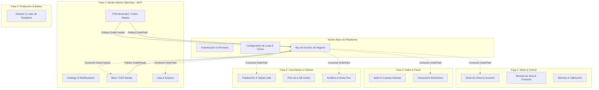
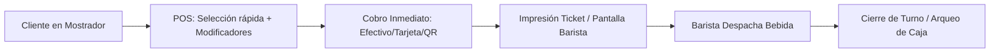
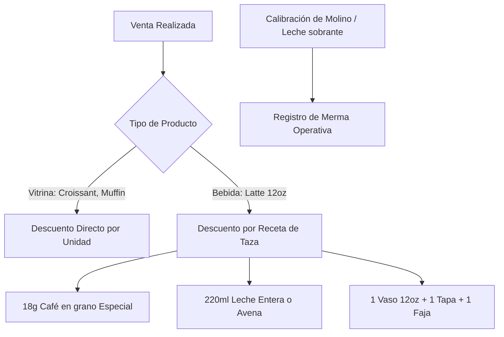
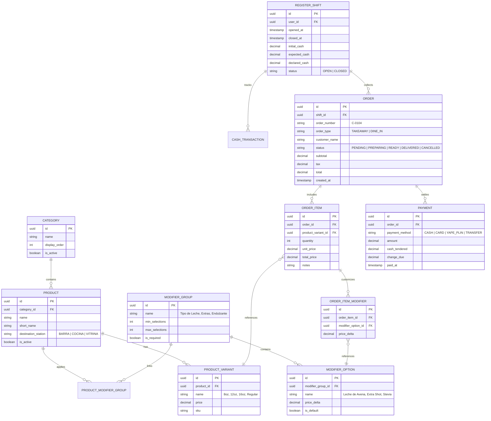

# Plan de Desarrollo Modular: Sistema Integral para Cafetería (CoffeeOS)

Este documento define la estrategia, arquitectura y hoja de ruta para el desarrollo modular de un sistema de gestión especializado para **cafeterías y barras de café**. 

A diferencia de un restaurante convencional, una cafetería opera con una alta proporción de **ventas en mostrador (Quick-Service / Pay-First)**, un ritmo de despacho de 90 a 180 segundos por bebida, un nivel crítico de **modificadores y personalización** (leches vegetales, dulzor, temperatura, shots extra), y dos tipos de existencias simultáneas (insumos dosificados por receta en barra vs. productos terminados por unidad en vitrina).

El objetivo central es **comenzar con lo más elemental para operar**, garantizando que cada módulo posterior (inventario, facturación electrónica, fidelización, producción) se conecte como un "bloque de Lego" a través de eventos y contratos bien delimitados.

---

## Goal Description

Construir una plataforma modular diseñada para cafeterías que permita:
1. **Fase Inicial (Lo más básico)**: Atender pedidos rápidamente en mostrador, personalizar bebidas con 1-2 toques, despachar en barra/cocina con visibilidad clara, cobrar con diversos medios de pago y cerrar caja con cuadre exacto.
2. **Crecimiento e Integración Futura**: Enchufar progresivamente módulos de control de insumos por gramaje/mililitro, facturación tributaria, cuentas de salón/mesas, obrador de pastelería y fidelización digital, sin alterar ni refactorizar el núcleo de ventas ya validado.

---

## User Review Required

> [!IMPORTANT]
> **Decisión de Arquitectura: Monolito Modular con Event-Driven vs. Microservicios**  
> Para iniciar con lo más básico sin sobrecostos de infraestructura (DevOps, redes, latencia), se propone un **Monolito Modular** en un solo repositorio backend con separación estricta de dominios (`Bounded Contexts`) y un **Bus de Eventos Interno**. Si el negocio escala a múltiples sucursales o franquicias en el futuro, los módulos pueden extraerse como microservicios individuales sin cambiar su lógica de negocio.

> [!NOTE]
> **Modelo Operativo de la Cafetería**  
> Se prioriza el flujo **Pay-First (Cobro en Mostrador antes de preparar)** como flujo predeterminado del MVP, ya que representa el 80% de la dinámica de cafeterías. En la Fase 3 se incorporará el soporte para cuentas abiertas y gestión de mesas para consumo en salón/coworking.

---

## Open Questions

> [!WARNING]
> 1. **¿Existe necesidad inmediata de emitir comprobantes fiscales electrónicos (ej. SUNAT en Perú / AFIP / SAT / DIAN) desde el día 1?**  
>    *Recomendación*: En el MVP inicial, gestionar tickets de control interno / comprobante simple con adaptadores listos para facturación, y activar el conector fiscal formal en la Fase 3 para no frenar la salida a producción.
> 2. **¿Qué hardware de punto de venta se utilizará principalmente?**  
>    *Recomendación*: Tablets táctiles (Android/iPad) o PCs táctiles todo-en-uno para el POS; tablet o monitor económico para el KDS de Barista; ticketera térmica USB/Bluetooth/Red para comandas impresas de respaldo.
> 3. **¿La cafetería cuenta con obrador/taller de pastelería propio o solo revende productos de terceros?**  
>    *Recomendación*: Si elaboran sus propios postres/panes, el módulo de producción por lotes de la Fase 4 será clave; si compran a terceros, solo se necesita el control de existencias de vitrina de la Fase 2.

---

## Arquitectura del Sistema: Diseño Modular Integrable

Para garantizar que lo básico pueda evolucionar hacia un sistema integral sin rehacer código, adoptamos el principio de **Límites de Contexto (Domain-Driven Design)** y **comunicación mediante Eventos de Dominio**.

### 1. Diagrama de Relación Modular



### 2. Principio Clave de Desacoplamiento (Zero-Coupling)
- El módulo de **POS** NO debe saber que existen inventarios, contabilidad ni tarjetas de puntos.
- El POS simplemente registra: *"Pedido #104 pagado con tarjeta por S/ 28.50 conteniendo 1 Cappuccino Grande (Leche Avena, Doble Shot) y 1 Croissant de Almendras"*.
- El POS dispara el evento `OrderPaidEvent`.
- Los módulos posteriores se suscriben de manera transparente:
  - **Fase 1 (MVP)**: La pantalla del Barista escucha `OrderCreatedEvent` y lo muestra en preparación; el módulo de Caja escucha `OrderPaidEvent` y suma el ingreso.
  - **Fase 2**: El módulo de inventario escucha `OrderPaidEvent` y descuenta 18g de café, 220ml de leche de avena y 1 unidad de croissant de almendras.
  - **Fase 3**: El módulo tributario escucha `OrderPaidEvent` y genera el XML/comprobante electrónico.
  - **Fase 5**: El módulo de fidelización escucha `OrderPaidEvent` y añade 1 sello a la tarjeta virtual del cliente.

---

## Roadmap de Desarrollo por Fases

### Fase 1: Núcleo Mínimo Operativo de Barra (MVP Lean)
*Objetivo: La cafetería abre, vende, personaliza pedidos, prepara y cierra caja con control total y rapidez.*



#### Módulo 1.1: Catálogo Especializado para Café & Vitrina
- Estructura jerárquica de productos pensada para bebidas y alimentos:
  - **Categorías**: Café Caliente, Bebidas Frías, Tés & Infusiones, Vitrina Dulce, Salados.
  - **Variaciones de Tamaño**: 8 oz, 12 oz, 16 oz (con precios diferenciales).
  - **Grupos de Modificadores**:
    - *Tipo de Leche* (Entera, Deslactosada, Avena [+S/2], Almendra [+S/2]).
    - *Temperatura* (Caliente, Tibio, Con hielo).
    - *Nivel de Endulzante* (Sin azúcar, 1/2 azúcar, Panela, Stevia).
    - *Extras* (Shot adicional de espresso [+S/3], Jarabe de Vainilla [+S/2], Crema batida).
    - *Instrucciones especiales de barra* (ej. "En taza térmica del cliente", "Espuma densa").
- Configuración de impuestos básicos (IGV incluido / no sujeto).

#### Módulo 1.2: POS de Mostrador Rápido (Quick-Service / Fast Checkout)
- Interfaz táctil de alto contraste y botones grandes para operar en pantallas táctiles o tablets.
- Selector de modificadores emergente al pulsar cualquier bebida (máximo 2 toques).
- Modo de orden: **"Para tomar aquí"** o **"Para llevar (Takeout)"** (fundamental para el tipo de vaso/empaque).
- Cobro multi-medio:
  - Efectivo (con cálculo automático de cambio/vuelto rápido con botones de denominación: S/10, S/20, S/50, S/100).
  - Billeteras digitales instantáneas (Yape / Plin / transferencias).
  - Tarjeta de crédito/débito (POS externo).
  - Pagos divididos simples (ej. mitad efectivo, mitad Yape).
- Emisión de ticket de venta interno y comanda de barra.

#### Módulo 1.3: Pantalla de Barista / Despacho (KDS de Barra)
- Diseñada para colocarse frente a la máquina de espresso o en la zona de retiro:
- Tarjetas de pedido con temporizador cromático:
  - Verde: < 2 minutos.
  - Amarillo: 2 a 4 minutos.
  - Rojo: > 4 minutos (alerta de demora).
- **Modificadores visualmente resaltados** (ej. "LECHE DE AVENA" en amarillo/negrita para evitar alérgenos y errores costosos).
- Botón rápido "Listo para entrega" / "Entregado" con sonido de notificación opcional.
- Soporte alternativo: Impresión de comanda física en ticketera de 58mm/80mm si la barra no usa tablet.

#### Módulo 1.4: Control de Caja & Turnos
- Apertura de caja con fondo inicial de sencillo/cambio.
- Registro de salidas de caja menores (gastos de emergencia, compra de hielo, propinas).
- Arqueo ciego de cambio al finalizar el turno (el cajero declara el dinero antes de ver el esperado del sistema).
- Cierre Z diario con resumen desglosado por medio de pago (efectivo, Yape, tarjeta).

#### Módulo 1.5: Reporte Diario Elemental
- Ventas totales del día vs. días anteriores.
- Top 10 productos más vendidos (volumen y recaudación).
- Desglose de ingresos por método de pago para conciliación bancaria inmediata.

---

### Fase 2: Control de Stock e Insumos Críticos
*Objetivo: Controlar dónde se va el dinero (granos de café, leche, descartables y vitrina) sin abrumar al barista.*



- **Stock de Vitrina**: Control de piezas unitarias directas (pasteles, galletas, bebidas embotelladas) con conteo de apertura y sobrante al cierre.
- **Recetas de Taza (Escandallo de Barra)**:
  - Definición de consumo por porción: Gramaje de café por dosis (ej. 9g simple, 18g doble), mililitros de leche por tamaño de vaso, unidades de descartables (vaso, tapa, fajilla).
- **Registro de Merma de Calibración de Molino**:
  - En especialidad de café, cada mañana y tarde el barista calibra la molienda (desperdicio controlado de 50g-100g de café). El sistema permite registrar "Ajuste por Calibración" para que el stock de café no presente descuadres falsos.
- **Alertas de Stock Crítico**: Notificación cuando la leche vegetal o los granos de café caigan por debajo del umbral mínimo de seguridad.

---

### Fase 3: Salón, Cuentas Abiertas y Facturación Electrónica
*Objetivo: Soporte para cafeterías con mesas/coworking y cumplimiento tributario automatizado.*

- **Gestión de Salón & Mesas**:
  - Plano visual de mesas y barras numeradas.
  - Cuentas abiertas: el cliente pide un café, luego un sándwich, y paga al retirarse.
  - Transferencia de cuenta entre mesas o fusión de cuentas.
  - División de cuenta (por persona o por items consumidos).
- **Capa Desacoplada de Facturación Electrónica**:
  - Adaptador independiente (`FiscalBillingAdapter`) que consume `OrderPaidEvent`.
  - Emisión de Boleta de Venta Electrónica y Factura con RUC/DNI.
  - Generación de PDF con código QR y envío de XML a la entidad tributaria (o mediante PSE/OSE).
  - Modo contingencia: Si el servicio tributario se cae o no hay internet, el POS continúa cobrando normalmente y encola los comprobantes para reenvío automático.

---

### Fase 4: Taller de Producción & Pastelería (Bakery/Obrador)
*Objetivo: Para cafeterías que hornean sus propios panes, postres y sándwiches.*

- **Órdenes de Horneado Matutino**:
  - Plan de horneado del día (ej. hornear 30 croissants, 20 brownies, 15 baguettes).
- **Consumo de Insumos por Lote**:
  - Descuento de harina, mantequilla, huevos, chocolate a partir de la receta matriz de producción.
- **Rendimiento y Merma de Cocina**:
  - Comparativa de unidades planificadas vs. unidades reales obtenidas vs. mermas por quemado o descarte.
- **Ingreso automático a stock de vitrina** disponible para el POS.

---

### Fase 5: Canales Digitales, Fidelización y Analítica Avanzada
*Objetivo: Retención de clientes recurrentes y expansión omnicanal.*

- **Tarjeta de Café Digital (Loyalty)**:
  - Sistema de fidelización por frecuencia (ej. "Compra 8 bebidas y la 9na es cortesía").
  - Identificación ágil mediante número de teléfono o QR escaneable desde el móvil del cliente.
- **Carta Digital & Pedido Anticipado (Pick-Up)**:
  - Menú web accesible por QR.
  - Pedido previo desde la oficina/calle para recoger en mostrador sin cola.
- **Business Intelligence (BI) de Cafetería**:
  - Mapa de calor de horas pico (identificación de picos de café matutino 8:00 - 10:30 am y merienda 4:30 - 7:00 pm) para optimizar turnos de baristas.
  - Margen bruto por taza según costo fluctuante del café y leches vegetales.

---

## Modelo de Datos Conceptual: Núcleo Inicial & Escalabilidad

A continuación se muestra el esquema relacional central para la **Fase 1**, diseñado con claves y relaciones preparadas para extenderse a las siguientes fases sin alteraciones destructivas:



---

## Contratos de Integración (Event Bus)

Los contratos formales garantizan que cualquier módulo futuro se integre sin tocar el código fuente del POS.

### Ejemplo de Evento de Integración: `OrderPaidEvent`
```typescript
interface OrderPaidEvent {
  eventId: string;
  eventType: 'ORDER_PAID';
  timestamp: string;
  payload: {
    orderId: string;
    orderNumber: string;
    orderType: 'TAKEAWAY' | 'DINE_IN';
    customerName?: string;
    customerDoc?: { type: 'DNI' | 'RUC'; number: string }; // Preparado para Facturación
    station: 'BARRA' | 'COCINA' | 'VITRINA';
    items: Array<{
      orderItemId: string;
      variantId: string;
      productName: string;
      variantName: string;
      quantity: number;
      unitPrice: number;
      modifiers: Array<{
        modifierOptionId: string;
        groupName: string;
        optionName: string;
        priceDelta: number;
      }>;
    }>;
    payments: Array<{
      method: 'CASH' | 'CARD' | 'DIGITAL_WALLET';
      amount: number;
    }>;
    totals: {
      subtotal: number;
      tax: number;
      total: number;
    };
  };
}
```

#### Suscriptores de este evento a través del tiempo:
1. **En Fase 1**:
   - `BaristaNotificationHandler`: Pone el ticket en la cola de la barra si no fue enviado previamente.
   - `CashShiftHandler`: Acumula el ingreso en el turno de caja abierto.
2. **En Fase 2**:
   - `InventoryDeductionHandler`: Descuenta los insumos por receta y los empaques.
3. **En Fase 3**:
   - `FiscalInvoiceEmitter`: Emite la boleta/factura electrónica al proveedor fiscal.
4. **En Fase 5**:
   - `LoyaltyPointsHandler`: Suma visitas/puntos a la cuenta del cliente.
   - `AnalyticsRealtimeHandler`: Actualiza los tableros de ventas y KPIs en vivo.

---

## Stack Tecnológico Recomendado

| Capa | Tecnología | Justificación |
| :--- | :--- | :--- |
| **Backend** | **Node.js con NestJS (TypeScript)** | Modular por diseño (`@Module`), soporte nativo de inyección de dependencias, bus de eventos integrado (`@nestjs/event-emitter`), excelente tipado y velocidad de desarrollo. |
| **Base de Datos** | **PostgreSQL + Prisma / TypeORM** | Transacciones ACID seguras (vital para cuadre de caja y stock), soporte relacional sólido y campos JSONB para flexibilidad de modificadores. |
| **Frontend POS / KDS** | **React / Next.js + Tailwind CSS** | Interfaz táctil ultra-rápida, responsive (adaptable a tablet de 10" o pantalla táctil de 15"), soporte PWA para cacheo de catálogo e interfaz en memoria. |
| **Tiempo Real** | **WebSockets (Socket.io / NestJS WebSockets)** | Notificación instantánea entre el cajero de mostrador y la pantalla de barista sin necesidad de recargar la página. |
| **Impresión** | **Librería de impresión ESC/POS** | Compatibilidad estándar para ticketeras térmicas de 58mm y 80mm de red (Ethernet/WiFi) o USB. |

---

## Verification Plan

### 1. Pruebas Automatizadas
- **Pruebas Unitarias**:
  - Verificación del cálculo de precios con múltiples modificadores (ej. Bebida base + tamaño + leche vegetal + doble shot).
  - Verificación del cálculo de vuelto/cambio en caja.
- **Pruebas de Contratos de Eventos**:
  - Test de publicación y consumo del evento `OrderPaidEvent`.
  - Asegurar que el fallo de un suscriptor no bloquee la confirmación de la venta en el POS.

### 2. Validación de Simulación Operativa (End-to-End)
- **Escenario 1: Apertura de Turno**:
  - El cajero abre turno con fondo inicial de S/ 100.00.
- **Escenario 2: Ráfaga de Pedidos en Mostrador**:
  - Pedido 1: 1 Americano 8oz con hielo + 1 Croissant de mantequilla. Pago en efectivo (S/ 50.00, cambio calculado).
  - Pedido 2: 1 Latte 12oz con Leche de Almendras y 1 shot extra. Pago con Yape.
  - Verificar que ambos pedidos aparezcan inmediatamente en la pantalla de Barista con la leche vegetal resaltada.
- **Escenario 3: Despacho de Barista**:
  - El barista marca "Listo para entrega"; el tiempo de preparación se cronometra.
- **Escenario 4: Cierre de Turno y Arqueo**:
  - Registro de un gasto menor de caja (S/ 15.00 compra de hielo).
  - Cierre de turno con declaración de efectivo; verificación de que el informe cuadre exactamente contra las ventas y salidas.
